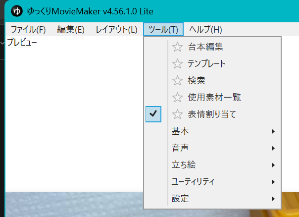
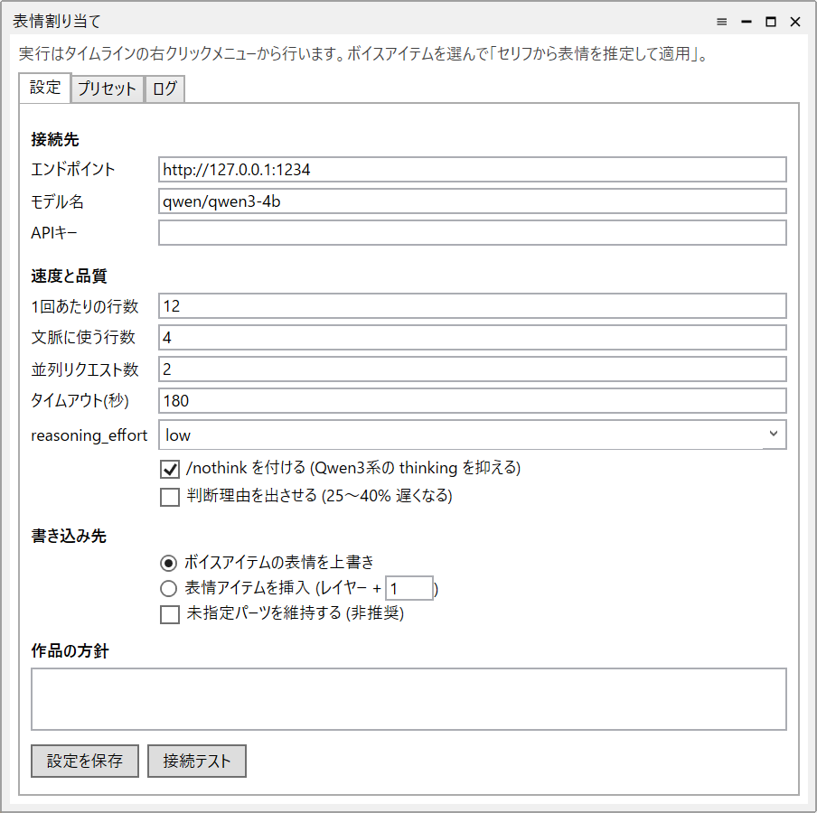

# YMM4 表情割り当てプラグイン

ゆっくりムービーメーカー4 (YMM4) のツールプラグインです。
ボイスアイテムのセリフを LLM に読ませ、キャラクターの**表情プリセット**を自動で割り当てます。

タイムラインでボイスアイテムを選び、右クリックから「セリフから表情を推定して適用」。
書き込みは **Ctrl+Z 1回** ですべて元に戻せます。

- OpenAI互換のチャットAPIなら何でも使えます。LM Studio や Ollama をローカルで動かせば、台本は外に出ません
- 割り当て先は `preset.ini` に定義済みの表情プリセットなので、素材に無い表情を勝手に作りません
- 判断がつかない行は**書き換えません**

## 動作環境

| | |
| --- | --- |
| YMM4 | v4.47.0.0 以降 (.NET 10 移行後)。開発・確認は v4.56.1.0 |
| 立ち絵 | **動く立ち絵 (AnimationTachie) のみ**。シンプル立ち絵・PSD立ち絵は対象外 |
| LLM | OpenAI互換のチャットAPI。ローカル (LM Studio / Ollama など) でもクラウドでも可 |
| ビルド | .NET 10 SDK |

## インストール

ビルド済みの DLL はリポジトリには含めていません (`bin/` は git 管理外)。
公開時に Releases へ `.ymme` を用意します。それまでは自分でビルドしてください ([開発](#開発) を参照)。

ビルドすると `YMM4フォルダ\user\plugin\FaceAssign\` へ自動でコピーされます。
手動で入れる場合は `FaceAssign.dll` をそのフォルダに置いて YMM4 を再起動します。
そのフォルダにはプラグインの DLL 以外を置かないでください (依存 DLL を一緒に置くと読み込みに失敗します)。

配布用の `.ymme` は、`FaceAssign.dll` を zip で固めて拡張子を `.ymme` に変えたものです。

## 初回セットアップ

インストールしただけでは動きません。次の5つを済ませてください。

### 1. LLM を用意する

OpenAI互換のチャットAPIであれば何でも使えます。どれか1つ用意してください。

| | エンドポイントの例 | 備考 |
| --- | --- | --- |
| LM Studio | `http://127.0.0.1:1234` | サーバ機能を有効にしておく |
| Ollama | `http://127.0.0.1:11434` | |
| OpenAI | `https://api.openai.com/v1` | APIキーが必要 |
| Gemini | `https://generativelanguage.googleapis.com/v1beta/openai/` | APIキーが必要。モデル名は `models/gemini-3.8-flash` のように `models/` から始まる。`reasoning_effort` は空に |

ローカルで動かせば台本は外に出ません。クラウドを使う場合は台本がそのサービスへ送られます。

モデルは小さめで足ります。手元では 4B 級で 10行あたり2〜3秒、
20B 級はその7倍ほど遅い代わりに選択の質が上がる、という結果でした → [実測メモ](docs/measurements.md)

### 2. ツールパネルを開く

YMM4 のメニューから **ツール → 表情割り当て**。

実行自体はパネルを開かなくてもできますが、設定はここで行います。



### 3. 接続先を設定する

設定タブでエンドポイントとモデル名を入れ、**「接続テスト」** を押します。
モデル一覧がログタブに出れば繋がっています。
最後に **「設定を保存」** を押してください (押さないと YMM4 の再起動で戻ります)。



詳しい値は [接続先の設定](#接続先の設定) を参照。

### 4. プリセット名を整える

**ここが精度を決めます。** 後述の [プリセット名を整える](#プリセット名を整える) に従って
`preset.ini` を直してください。

### 5. 動作を確認する

ボイスアイテムを1件だけ選んで右クリック → 「セリフから表情を推定して適用」。
表情が変われば成功です。**Ctrl+Z 1回** で元に戻せます。

<!-- スクリーンショット: 右クリックメニュー

-->

うまくいかないときはパネルのログタブを見てください。接続できない、モデル名が違う、
プリセットが読めていない、といった理由がそのまま出ます。

## 使い方

### プリセット名を整える

素材を追加したときや、割り当ての質が上がらないときに見直す項目です。

精度はほぼ**プリセット名の付け方で決まります**。LLM は `preset.ini` のセクション名を手がかりに選ぶためです。

名前の付け方の目安は次のとおりです。

| 区分 | 名前 |
| --- | --- |
| 必須 | 標準 / 笑顔 / 怒り / 悲しみ / 驚き / 照れ / 困惑 / 呆れ |
| 推奨 | 大笑い / 焦り / 得意 / 真剣 / 不安 / 不満 |
| 任意 | 泣き / 眠い / 無表情 / 疑問 |

命名のルール:

- **感情を表す一般的な語**にする。擬音 (`ぬーん` `パカー`) は LLM が意味を取れない
- 強度は語幹＋語で分ける (`笑顔` / `大笑い`)。数字だけの区別 (`考える2`) は避ける
- **ポーズだけのプリセット (`指差し` `食べる` `カメラ目線`) は混ぜない。** 感情と動作が同じ一覧に並ぶと、
  モデルは動作の軸で答えてよいことになり、怒りの行に `指差し` を返したりする (実測。理由は「怒りで指差している」だった)
- 同名セクションを作らない
- 1キャラ 8〜15個

`preset.ini` はプラグインからは**書き換えません**。YMM4 本体の表情プリセット機能かテキストエディタで編集してください。
読み込みは実行のたびに行うので、編集後に何か操作する必要はありません (YMM4 を起動したまま編集すると
YMM4 側が上書きすることがあるので、編集は YMM4 を終了してから)。

### 接続先の設定

エンドポイントの一覧は [1. LLM を用意する](#1-llm-を用意する) を参照。
設定タブに入れて「接続テスト」を押すと、モデル一覧がログタブに出ます。

初期値は `http://127.0.0.1:1234` と `qwen/qwen3-4b` です。
モデル名は接続先での呼び名をそのまま使います (Ollama なら `ollama list` に出る名前)。
空のまま接続テストを押すと、一覧の先頭が自動で入ります。

パスを含む URL (Gemini のような) もそのまま使えます。

APIキーは設定ファイルに平文では書きません。Windows の DPAPI (CurrentUser) で暗号化した値だけが残ります。
ただしこれは**設定ファイルを他のマシンや他のユーザーに持ち出されたときに読めなくする**もので、
同じ Windows ユーザーで動くプロセスからは復号できます。そこまでの保護が要るなら、
キーを保存せず都度入力する運用にしてください。

Gemini は動作を確認済みです (`json_schema` も受け付けます)。OpenAI と Claude は未確認なので、
エンドポイントとモデル名が正しいかは接続テストと1行だけの実行で確かめてください。

**接続テストが通っても、そのモデルが使えるとは限りません。** モデル一覧には提供が終了したものも
含まれることがあり、実際に呼ぶまで分かりません (Gemini で `models/gemini-2.5-flash` が
「新規ユーザーには提供されていない」と返ってきました)。失敗の理由はログタブに出ます。

### 実行する

タイムラインでボイスアイテムを選択 → 右クリック → 「セリフから表情を推定して適用」。

- 対象は**選択中のボイスアイテムだけ**です
- 書き込み先は設定タブで選べます (ボイスアイテムの表情を上書き / 表情アイテムを挿入)
- 結果はログタブに出ます。ツールパネルを開いていなくても実行できます

## 設定

すべてツールパネルの設定タブにあります (YMM4 の設定画面には出しません)。
保存先は `YMM4フォルダ\user\setting\<version>\FaceAssign.Settings.FaceAssignSettings.json`。

| 項目 | 説明 |
| --- | --- |
| 1回あたりの行数 | 多すぎるとモデルが後半を落とします。取りこぼしは自動で聞き直します |
| 文脈に使う行数 | 対象の手前を何行、文脈として送るか。増やすと遅くなります |
| 並列リクエスト数 | 既定 1。増やして速くなるかはモデル次第で、合わないと桁違いに遅くなる (qwen3-4b で 26秒→535秒)。変えるなら実測してから |
| reasoning_effort | gpt-oss 系で効きます。medium は low の約2倍遅い |
| /no_think を付ける | Qwen3 系の thinking を抑えます |
| 判断理由を出させる | 25〜40% 遅くなります。既定はオフ |
| 未指定パーツを維持する | 既定オフ。オフのときは12スロット全部を書き、プリセットが指定しないパーツは未選択に戻します |

APIキーは `ProtectedApiKey` として DPAPI で暗号化して保存されます。
以前のバージョンが平文で書いた `ApiKey` があれば、読み込み時に引き継いで次回保存で暗号化側へ移します。

## 仕組み

1. 選択されたボイスアイテムをキャラクターごとに分け、`preset.ini` のプリセット一覧を候補にする
2. 台本を組み立てて OpenAI互換APIへ送る。**出力は候補の番号**に JSON スキーマで縛る
3. 返ってきた番号を表情パラメータの12スロットに書き込み、`UndoRedoManager.Record()` を1回だけ呼ぶ

詳しい設計と、YMM4 の内部APIについて調べた結果は [docs/design.md](docs/design.md) に、
速度・精度の実測値は [docs/measurements.md](docs/measurements.md) にあります。

## 制限

- 動く立ち絵専用です。他形式のキャラクターはスキップし、まとめて警告を出します
- プリセットに無い表情は作れません。精度はプリセット名の整備に依存します
- 右クリックメニューへの差し込みと、パネルを開かずに動かす部分は **YMM4 の非公開APIに依存**しています。YMM4 の更新で動かなくなる可能性があります。その場合もメニュー項目が出なくなるだけで、YMM4 自体は壊れません

## 開発

```
dotnet build FaceAssign/FaceAssign.csproj
```

`Directory.Build.props.sample` を `Directory.Build.props` にコピーし、YMM4 のインストール先を書きます (末尾の `\` が必要)。
ビルド後に `user\plugin\FaceAssign\` へ自動でコピーされます。
**YMM4 が起動中は DLL がロックされてコピーできません**。警告が出たら YMM4 を終了してビルドし直してください。

| 場所 | 中身 |
| --- | --- |
| `FaceAssign/` | プラグイン本体 |
| `tests/PresetIniTests/` | `preset.ini` パーサと書き込みロジックの検証 (ネットワーク不要) |
| `tests/LlmSmoke/` | 実サーバに対する速度・精度の計測 |
| `tools/ApiProbe/` | YMM4 アセンブリの型・メンバを調べるプローブ |

## ライセンス

[MIT License](LICENSE) です。

- YMM4 本体の DLL (`YukkuriMovieMaker*.dll` など) はリポジトリにも配布物にも含めていません。ビルド時はインストール済みの YMM4 から参照します
- 本プラグインは有志による非公式のものです。YMM4 の開発者へは問い合わせないでください
- 使用によって生じた損害について、作者は責任を負いません
- クラウドの LLM を使う場合は、そのサービスの利用規約に従ってください
